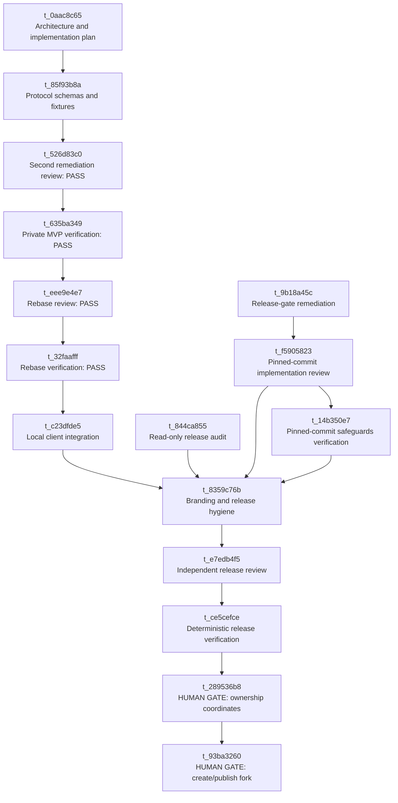

# Barebuh workstreams

This document mirrors the Kanban dependency graph by task ID. Kanban state is
a live operational record; this file is the release traceability snapshot for
the local client line.

## Gate semantics

- Initial implementation commit `b8826cf5d7b607046731360644e546271f591844`
  and DAG commit `a6a133669d33fd98682ba487f4687a4ad2a6a36a` were superseded after review.
  Remediation task `t_9b18a45c` produced final candidate
  `8c44141d305646de9ccb57ce59097c6af5d1e491`.
- `t_f5905823` and `t_14b350e7` are the pre-completion review and safeguards
  verification gates for that exact final candidate.
  They use active project profiles and keep `t_8359c76b` pending until both
  return evidence.
- Completed implementation is not approval. `t_e7edb4f5` must return an explicit
  PASS before `t_ce5cefce` may verify the same exact commit.
- `t_ce5cefce` approves only an unsigned local candidate. It does not authorize
  a remote, signing, upload, package repository, update feed, or announcement.
- `t_289536b8` is blocked until a human supplies the forge, owner/organization,
  repository name, visibility, canonical URLs, release destination, signing
  identity, and remote policy.
- `t_93ba3260` is a second blocked human gate for the actual external action.
  Ownership choices do not themselves authorize creation or publication.
- Superseded task `t_2ac60841` and its old verification lane are intentionally
  omitted from the active path because they pointed at the primary checkout;
  the corrected exact-worktree lane above preserves the same acceptance gates.

## Remaining independent workstreams

Registry-node implementation, deployment, protocol-namespace governance,
translation service, binary packaging, reproducible toolchain closure, and
public support/governance are separate workstreams. They must receive their own
task-ID DAGs before execution and must not be inferred from this client-release
lane.
